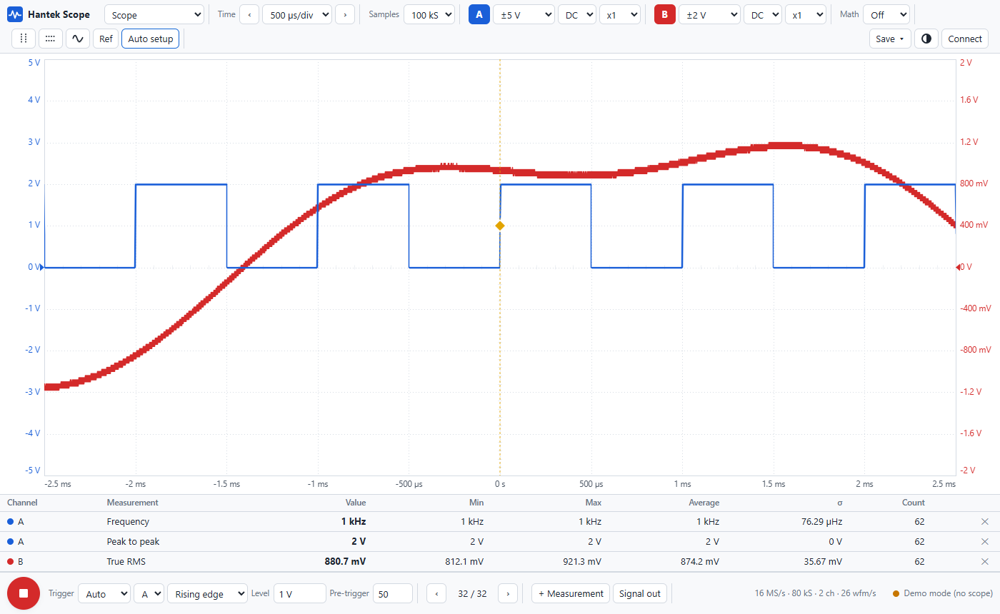

# Hantek Scope

An oscilloscope app in the style of PicoScope, for the **Hantek DSO-6022BE** and **DSO-6022BL** USB scopes. It runs in Chrome or Edge using WebUSB, so there's nothing to compile and no vendor driver.



## Features

- Two channels with ranges from ±50 mV to ±5 V (×1). Probe settings x1, x10, x20 and x100 scale the ranges.
- **Triggering:** None / Auto / Repeat / Single, on a rising or falling edge or on pulse width (> or <). Drag the trigger marker to set the level and pre-trigger.
- **Measurements table** with live value, min, max, average, σ and count. Measures frequency, period, duty cycle, pulse widths, DC average, true RMS, AC RMS, min/max, peak-to-peak, rise/fall time and edge count.
- **Analysis:**
  - Time and signal rulers (Δt, 1/Δt, values at each ruler)
  - Spectrum view (FFT with a Blackman-Harris window), alone or split with the scope view
  - Persistence mode and a reference trace
  - Maths channel: A+B, A−B, B−A, A×B, −A
- **Navigation:** waveform buffer (last 32 captures), mouse-wheel zoom and pan.
- **Auto setup** picks the ranges, timebase and trigger level for you.
- **Slow sampling:** at 100 ms/div and slower the scope streams continuously.
- **Files:** saves waveforms to CSV (one capture or the whole buffer) and the screen to PNG. Opens its own CSV files and CSV exports from PicoScope.
- Sets the frequency of the probe-comp output.
- Light and dark themes. Settings are remembered between sessions.
- **Demo mode** with a simulated scope, so you can try it without hardware.

## Requirements

- [Node.js](https://nodejs.org) 18 or newer. It's only used to serve the page on `localhost`, because WebUSB needs a secure origin.
- Google Chrome or Microsoft Edge (or another Chromium browser). Firefox and Safari don't support WebUSB.
- **Windows:** the scope must use the **WinUSB** driver, not Hantek's own driver. Install it with [Zadig](https://zadig.akeo.ie/), or with the driver `.inf` that comes with [OpenHantek6022](https://github.com/OpenHantek/OpenHantek6022). If OpenHantek6022 already works on your PC, you're set. The scope shows up as two USB devices, `04B4:6022` (before firmware is loaded) and `04B5:6022` (after), and both need WinUSB.
- **Linux:** add a udev rule so your user can access the device. The OpenHantek6022 `60-openhantek.rules` file works.

## Running it

**Windows:** double-click `Start Hantek Scope.bat`.

**Any OS:**

```sh
npm start        # or: node server.js
```

This serves the app at <http://localhost:8022> and opens it in a Chrome or Edge app window.

### The first connection

The 6022 has no permanent firmware. Every time it's plugged in, the app has to load the firmware into it:

1. Click **Connect** and choose the scope. It may be listed as an unknown device.
2. The app loads the firmware and the scope restarts (about 2 seconds).
3. The first time only, click **Connect** again and choose **DSO-6022BE**. After that the browser remembers the scope and the app reconnects automatically.

Only one program can use the scope at a time, so close OpenHantek and the Hantek software first.

## Controls

| Action | How |
|---|---|
| Start / stop | Round button, or <kbd>Space</kbd> |
| Step through the buffer | ‹ › buttons, or <kbd>←</kbd> <kbd>→</kbd> |
| Trigger level and pre-trigger | Drag the yellow diamond |
| Channel offset | Drag that channel's axis numbers up or down |
| Zoom the time axis | Mouse wheel over the graph. Drag to pan, double-click to reset |
| Rulers | Ruler buttons in the toolbar, then drag the dashed lines |

## Hardware limits

- 8-bit samples, about 20 MHz bandwidth.
- The scope has no onboard memory, so every sample goes over USB 2.0, which tops out around 36–40 MB/s.
  - Reliable maximums: 24 MS/s with both channels, 48 MS/s with channel A only (switch channel B and the maths channel off).
  - If the PC falls behind, samples are lost and the status bar shows **USB too slow**.
- Input range is ±5 V with a ×1 probe. Use a ×10 probe or an attenuator for higher voltages.
- AC coupling needs the hardware AC/DC mod. Without it, the app removes the DC part in software.

## Project layout

| File | Purpose |
|---|---|
| `index.html` | Layout and styling |
| `app.js` | Acquisition loop, triggering, drawing, interaction, save/open |
| `scope-driver.js` | Hantek 6022 USB driver (WebUSB API) |
| `firmware.js` | The FX2 firmware loaded into the scope |
| `dsp.js` | Trigger detection, measurements, FFT, number formatting |
| `sim-scope.js` | Simulated scope for demo mode |
| `server.js` | Local static web server and browser launcher |

`scope-driver.js` only uses the standard WebUSB API, so you can also use it from Node with the [`usb`](https://www.npmjs.com/package/usb) package's `WebUSB` class. That's handy for scripting captures.

## Credits

- The firmware and USB protocol come from [Hantek6022API](https://github.com/Ho-Ro/Hantek6022API) by Ho-Ro (Martin Homuth-Rosemann), Robert Cope and Jochen Hoenicke. It's the same firmware [OpenHantek6022](https://github.com/OpenHantek/OpenHantek6022) uses.

## License

GPL-3.0-or-later. See [LICENSE](LICENSE). The firmware in `firmware.js` is GPLv3, by the Hantek6022API authors.

This is an independent project. It isn't affiliated with or endorsed by Hantek or Pico Technology. PicoScope is a trademark of Pico Technology Ltd.
